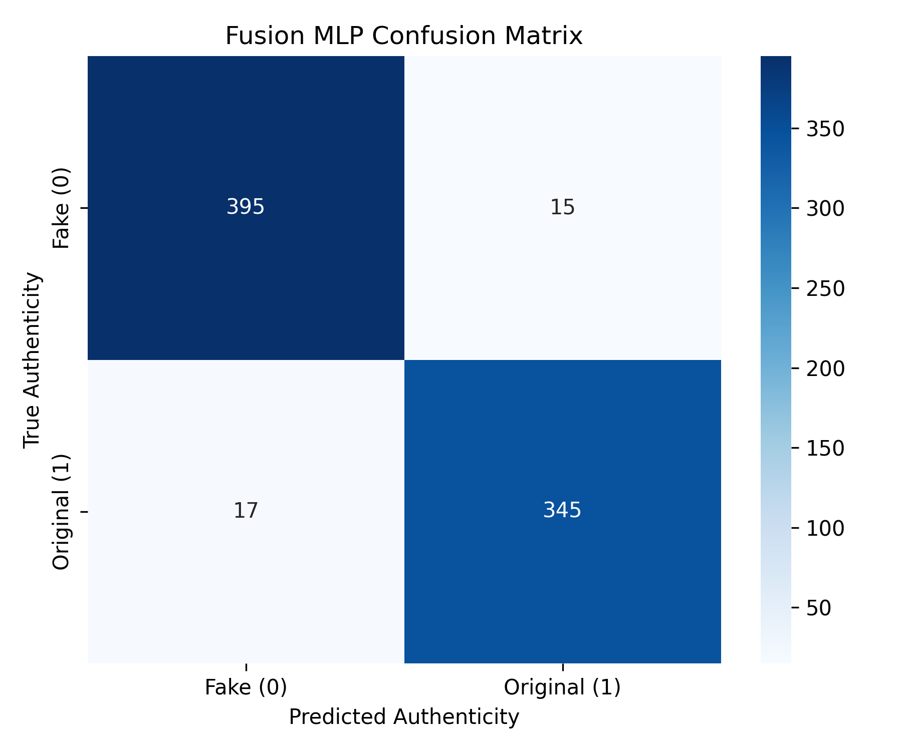
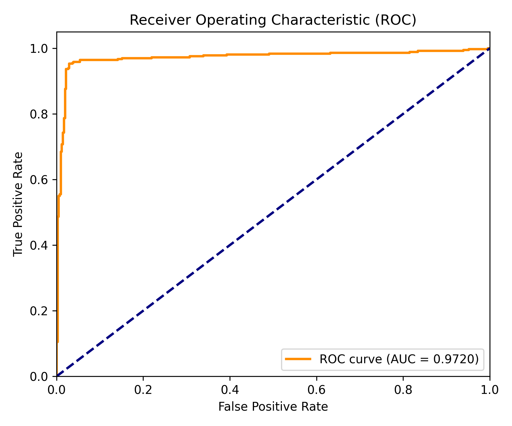
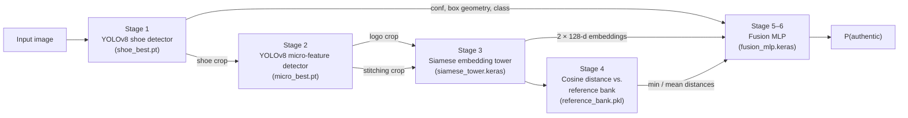

# 👟 Deep CNN-Siamese Sneaker Authenticator

Counterfeit detection for Nike Air Force 1 and Air Jordan 1 using micro-feature analysis.

This repository is the research prototype for my M.S. in Artificial Intelligence thesis at Minnesota State University, Mankato: *"Deep CNN-Siamese Integration for Luxury Footwear Micro-Feature Authentication."*

Instead of judging a sneaker from one global image, the system mimics how a human authenticator works: it finds the shoe, zooms into the details counterfeiters most often get wrong (the logo and the stitching), compares those details against a bank of reference crops, and fuses everything into a single authenticity score. Multiple photos of the same pair can be uploaded and their scores are ensembled.

## Results at a glance

| Component | Metric | Score |
|---|---|---|
| Whole-shoe detector (YOLOv8n, DS1) | mAP@50 / mAP@50-95 | 0.924 / 0.780 |
| Micro-feature detector (YOLOv8n, DS3) | mAP@50 / mAP@50-95 | 0.761 / 0.652 |
| Fusion MLP (authentic vs. counterfeit) | Accuracy | **95.85%** |
| | Precision / Recall / F1 | 0.958 / 0.953 / 0.956 |
| | ROC-AUC | 0.972 |
| End-to-end pipeline (Tesla T4) | Mean / p95 latency per image | 54.4 ms / 64.7 ms |

Evaluated on a stratified 20% hold-out of DS1 (772 images).

<p align="center">
  
  
</p>

Of 772 validation images: 395 fakes and 345 originals were classified correctly; 15 fakes were passed as authentic and 17 originals were flagged as counterfeit.

## How it works



1. **Whole-shoe detection.** A YOLOv8n model trained on DS1 locates the sneaker and predicts one of four classes (fake/original × Air Force 1/Jordan 1). The highest-confidence box is cropped.
2. **Micro-feature detection.** A second YOLOv8n model trained on DS3 runs inside the shoe crop and finds the best `ShoeLogo` and `StitchingPatterns` regions.
3. **Siamese embeddings.** Each micro-crop is resized to 128×128 and passed through a lightweight CNN tower (3 conv blocks → GAP → Dense(128) → L2 normalization), trained with contrastive loss.
4. **Reference-bank comparison.** Each embedding is compared to up to 200 stored reference embeddings per feature type; the min and mean cosine distances are recorded.
5. **Feature fusion.** A 267-dimensional vector is assembled:
   - 4 distance statistics (logo min/mean, stitch min/mean)
   - 3 detection stats (shoe confidence, box-to-image area ratio, box aspect ratio)
   - 4-way one-hot of the shoe detector's class
   - 128-d logo embedding + 128-d stitching embedding
6. **Classification.** A small MLP (Dense 128 → Dropout 0.3 → Dense 64 → sigmoid) outputs the probability the shoe is authentic.
7. **Multi-angle ensemble (app only).** When several photos are uploaded, angles with no detected shoe are skipped and the remaining scores are mean-pooled. ≥ 0.5 → **AUTHENTIC**, otherwise **COUNTERFEIT**.

## Repository layout

```
.
├── app.py                               # Streamlit app: multi-angle ensemble inference
├── counterfeit_sneaker_detection.ipynb  # Training notebook (Colab)
├── authenticator.ipynb                  # Colab cell that writes an earlier version of app.py
├── shoe_best.pt                         # Stage 1: whole-shoe YOLOv8n weights (DS1)
├── micro_best.pt                        # Stage 2: logo/stitching YOLOv8n weights (DS3)
├── siamese_tower.keras                  # Stage 3: embedding tower
├── fusion_mlp.keras                     # Stage 6: fusion classifier
├── reference_bank.pkl                   # Stage 4: {"ShoeLogo": ndarray, "StitchingPatterns": ndarray}
├── confusion_matrix.png                 # Evaluation figures
├── roc_curve.png
├── requirements.txt                     # Pinned Python dependencies
└── packages.txt                         # System dependency (libgl1) for Streamlit Community Cloud
```

## Quick start

Requires Python 3.10–3.12. TensorFlow 2.16 does not support NumPy 2.x, so `requirements.txt` pins NumPy < 2.

```bash
git clone https://github.com/kevinonomah/Nike-Sneaker-Counterfeit.git
cd Nike-Sneaker-Counterfeit

python -m venv .venv
source .venv/bin/activate          # Windows: .venv\Scripts\activate

pip install -r requirements.txt
streamlit run app.py
```

Then open http://localhost:8501, upload one or more photos of the same pair (side, heel, toe box, sole), and click **Authenticate Sneaker**.

On Linux you may need OpenCV's system library: `sudo apt-get install libgl1`.

### What the app shows

- A preview grid of every uploaded angle
- For each angle: the detected shoe, logo and stitching crops, each with its nearest reference distance
- The ensemble verdict with confidence
- A per-angle score table and total inference latency

### Using the pipeline from Python

```python
import pickle, numpy as np, tensorflow as tf
from PIL import Image
from ultralytics import YOLO

yolo_shoe  = YOLO("shoe_best.pt")
yolo_micro = YOLO("micro_best.pt")
tower      = tf.keras.models.load_model("siamese_tower.keras", compile=False)
mlp        = tf.keras.models.load_model("fusion_mlp.keras",   compile=False)
ref_bank   = pickle.load(open("reference_bank.pkl", "rb"))

# authenticate_single lives in app.py; import it once the UI code is moved
# under an `if __name__ == "__main__":` guard (see Roadmap).
```

## Datasets

| ID | Name | Task | Classes | Size |
|---|---|---|---|---|
| DS1 | Nike Shoes Detection | Whole-shoe detection + authenticity label | nike fake air force, nike fake jordan 1, nike original air force, nike original jordan 1 | 3,860 images (771 in the YOLO val split) |
| DS3 | Real Fake Sneakers | Micro-feature detection | ShoeLogo, StitchingPatterns | 1,112 images |

Both are YOLO-format exports (Roboflow). They are not included in this repository because of size. The training notebook expects:

```
<BASE_DIR>/
├── Nike Shoes Detection/   data.yaml, train/ valid/ test/ {images,labels}
└── Real Fake Sneakers/     data.yaml, train/ valid/ test/ {images,labels}
```

DS1's four detector classes are collapsed to a binary authenticity label (fake = 0, original = 1) for the fusion stage.

## Reproducing training

The notebook `counterfeit_sneaker_detection.ipynb` was run on Google Colab with a Tesla T4. To reproduce:

1. Upload both datasets to Google Drive and set `CONFIG["BASE_DIR"]` (default `/content/drive/MyDrive/Datasets`).
2. Run the cells in order. The main cell trains every stage end-to-end:
   - **Stage 1:** YOLOv8n on DS1 (640 px, 50 epochs, batch 16)
   - **Stage 1.5:** YOLOv8n on DS3 (same settings)
   - **Stage 2:** Siamese tower on ground-truth DS3 crops (128×128, 30 epochs, contrastive margin 1.0, ≤2,000 pairs per class)
   - **Stage 3:** Reference bank of ≤200 embeddings per feature, then 267-d features extracted for every DS1 image
   - **Stage 4:** Fusion MLP (80/20 stratified split, 50 epochs, batch 16, Adam)
3. The following cells generate the confusion matrix/ROC figures, benchmark latency on 100 images, and pickle the reference bank.
4. Copy the YOLO `best.pt` files from `runs/detect/ds1_shoe_detector*/weights/` and `runs/detect/ds3_micro_detector*/weights/` into this repo as `shoe_best.pt` and `micro_best.pt`.

Random seed is fixed at 42 for NumPy, TensorFlow and Python.

## Limitations

- **Scope.** Trained only on Nike Air Force 1 and Air Jordan 1. Other silhouettes or brands are out of distribution and will produce unreliable scores.
- **Micro-feature detector is the weak link.** At mAP@50 0.761, logo and stitching boxes are sometimes missed; the app then feeds a blank crop into the tower. Known causes are aggressive Roboflow augmentations and inconsistent annotations in DS3.
- **Evaluation is a single split.** Metrics come from one 80/20 split of DS1 rather than a separate test set or cross-validation, and DS1 may contain augmented near-duplicates that land on both sides of the split.
- **Not a certified authentication service.** This is a research prototype. Do not use it as the sole basis for a purchase or resale decision.

## Roadmap

- [ ] Re-export DS3 cleanly (Roboflow v3, no destructive augmentations) and re-annotate into a 4-class scheme
- [ ] Retrain the micro detector with YOLOv8s at `imgsz=1280` so small stitching details survive downscaling
- [ ] Train the Siamese tower on genuine-vs-counterfeit pairs of the same feature type, and build the reference bank from genuine crops only
- [ ] Ablation study: fusion MLP with and without the shoe detector's class one-hot, to measure how much the micro-features contribute on their own
- [ ] Group-aware train/val/test split and k-fold cross-validation
- [ ] Get per-image latency under 50 ms (ONNX/TensorRT export, batch the two YOLO stages)
- [ ] Move `app.py` logic into an importable `authenticator/` package with unit tests

## Tech stack

Python · Ultralytics YOLOv8 · TensorFlow/Keras · OpenCV · scikit-learn · NumPy · Streamlit · Google Colab

## Author

**Kevin Benjamin Osei-Onomah**
M.S. Artificial Intelligence candidate, Minnesota State University, Mankato
Thesis advisor: Dr. Rajeev Bukralia

[GitHub](https://github.com/kevinonomah)

If you use this work, please cite:

```bibtex
@mastersthesis{oseionomah2026sneaker,
  author = {Osei-Onomah, Kevin Benjamin},
  title  = {Deep CNN-Siamese Integration for Luxury Footwear Micro-Feature Authentication},
  school = {Minnesota State University, Mankato},
  year   = {2026}
}
```

## License

No license has been chosen yet, so all rights are reserved by default. Open an issue if you would like to reuse the code or models.
